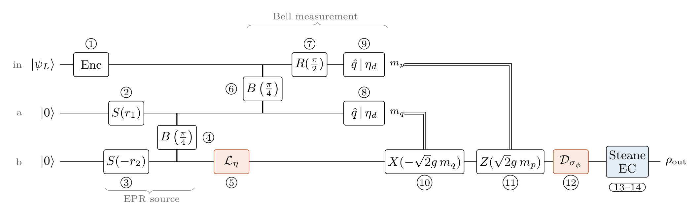
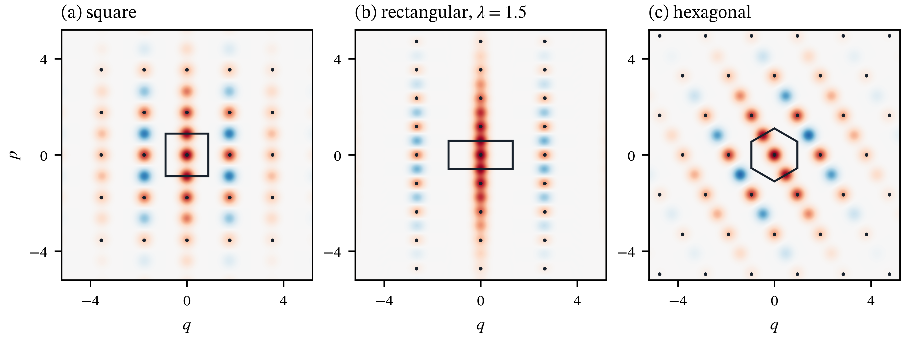
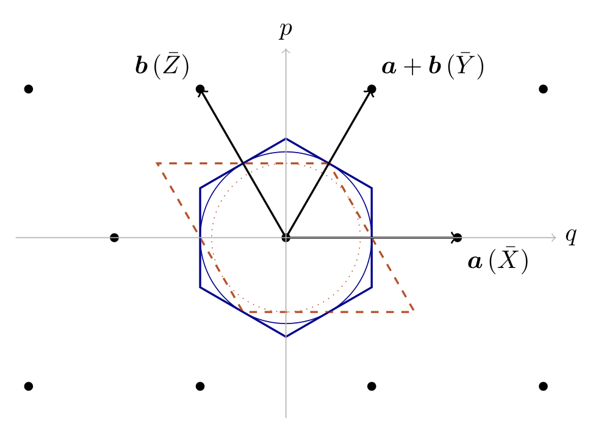
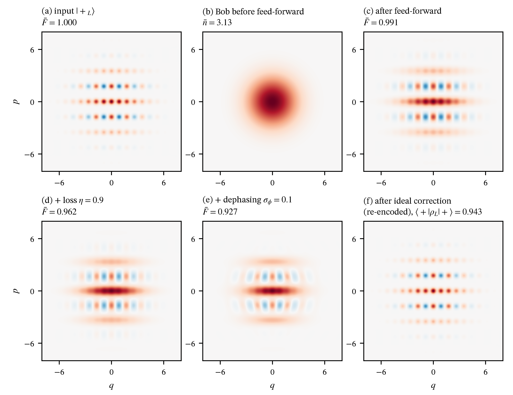
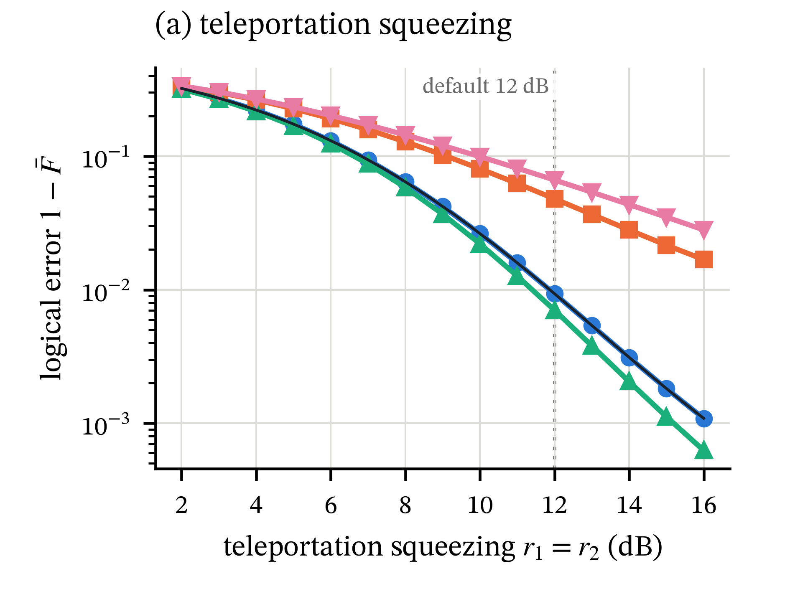
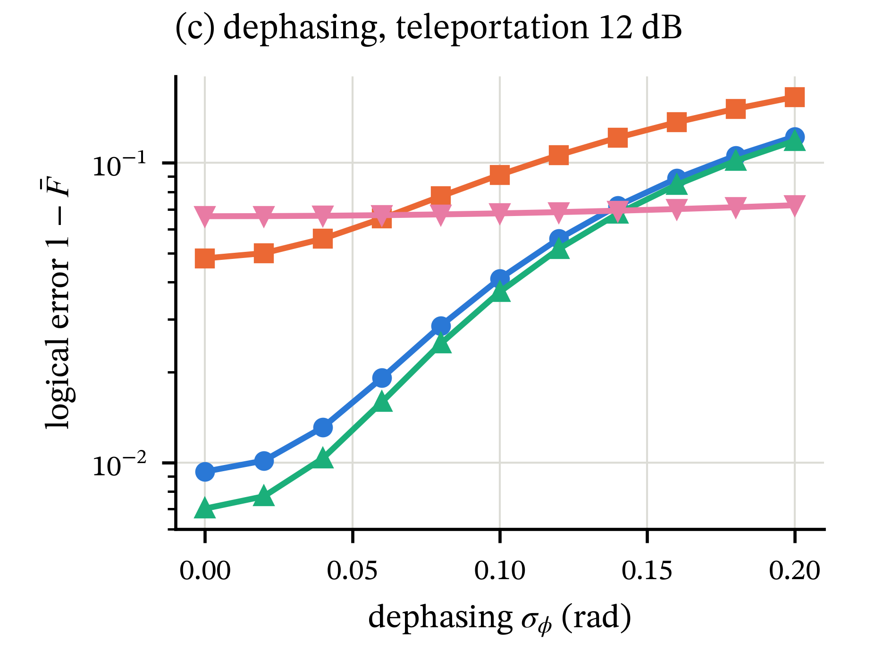
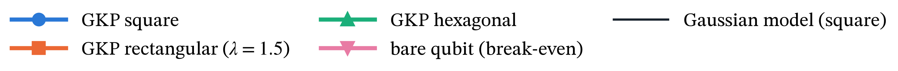

# GKP-QEC-simulator

A continuous-variable circuit simulator in QuTiP, built for the final project of "Modern Quantum Computing"
(Technion 00460054, Uri Kasher Hitin, 2026). A logical qubit is encoded in a GKP code (square, rectangular
lambda = 1.5, or hexagonal), sent through CV teleportation with realistic imperfections, corrected, and scored by the
average fidelity F = (2F_e + 1)/3 against an unencoded (bare) qubit.

**Full report:** [report/full report.pdf](report/full%20report.pdf)

- Imperfections: finite squeezing, channel loss, detector inefficiency, dephasing, and asymmetric squeezing.
- Decoders: ideal (nearest lattice point), a realistic Steane-type round with finite GKP ancillas, and a Petz benchmark.
- Two engines: an exact three-mode Fock simulation of all 14 circuit components, and the equivalent single-mode
  channel (verified against the exact engine to a trace distance of 8.5e-7), which runs all sweeps at N = 140.

## The circuit

<p align="center"></p>

An encoded GKP state (1) is teleported with a two-mode squeezed EPR pair (2-4). Alice's Bell measurement is a beam
splitter and two homodyne detectors (6-9); Bob undoes the measured shifts with a feed-forward (10-11) and then runs a
Steane-type GKP correction round (13-14). The orange boxes are the imperfections: channel loss (5), detector
inefficiency (8, 9) and dephasing (12). Finite squeezing in the EPR pair makes the teleported state arrive shifted by
random Gaussian amounts, which is exactly the error GKP codes are built to correct.

## The codes

<p align="center"></p>

Wigner functions of the logical |0> of the three lattices at equal energy (Delta = 0.3, mean photon number about 5).

<p align="center"></p>

The hexagonal lattice corrects any shift that stays inside the hexagon (inradius 0.952, against 0.886 for the square).
Correcting q and p separately shrinks it to the dashed parallelogram (inradius 0.825), so the hexagonal code only
keeps its advantage when both syndromes are decoded jointly.

## The circuit, stage by stage

<p align="center"> at each stage of the circuit"></p>

Square GKP |+>_L at 12 dB teleportation squeezing: (a) the input, (b) Bob's mode before the feed-forward (no
information about the input), (c) after the feed-forward (blurred by the squeezing noise), (d) with channel loss,
(e) with dephasing, which smears far peaks along circles, and (f) after ideal correction.

## Selected results

<p align="center">

<br>

</p>

- **GKP beats the bare qubit across the whole 2-16 dB range.** At 12 dB the logical error is 0.009 (square) and
  0.007 (hexagonal) against 0.066 for the bare qubit (left).
- **Dephasing is GKP's weak spot.** A rotation moves far peaks by large amounts. Beyond about 0.14 rad both
  symmetric codes are worse than the bare qubit, which hardly notices dephasing (right).
- **The best lattice is the one whose cell matches the noise.** The hexagon is best for symmetric noise. The
  rectangular code wins only when q is much noisier than p (0.020 against 0.055 for the hexagon at a 12 dB bias).
- **A realistic correction round is limited by its ancillas.** With every imperfection on at once, a Steane round
  with Delta_a = 0.3 ancillas only narrowly beats the bare qubit (0.110 against 0.121 at 12 dB). Better ancillas
  keep a clear margin.

All figures, tables and numbers are generated from the data in `results/`; see
[results/README.md](results/README.md) and [report/figures/README.md](report/figures/README.md).

## Layout

| path | contents |
|---|---|
| `cvqec/` | the library: conventions, gates, codes, noise channels, circuits, engines, decoders, metrics, experiments CLI |
| `tests/` | 131 physics tests with documented tolerances (`docs/TEST_PLAN.md`) |
| `results/` | the data behind every figure, table and number of the report: one csv + json per experiment preset, plus two archives of superseded runs. [results/README.md](results/README.md) says which file feeds which figure and what each column means |
| `report/full report.pdf` | the submitted report |
| `report/run_sweeps.py` | stage 1: runs every preset into `results/` (~12 min) |
| `report/make_figures.py` | stage 2: figures, tables and number macros from `results/` (~2 min) |
| `report/figures/` | the figures of the report (PDF + 600 dpi PNG) and the two TikZ drawings (circuit, hexagonal cell). [report/figures/README.md](report/figures/README.md) maps each file to its figure number |
| `scripts_ext/`, `results_ext/` | side studies not used in the report (GKP vs cat under rotations and shifts, wrong feed-forward gain, optimal-decoder benchmark, convergence). [results_ext/README.md](results_ext/README.md) |
| `docs/` | handoff, implementation log, test plan, runbook, meaning of every generated number (`results_numbers.md`), lessons learned |

## Usage

```bash
conda env create -f environment.yml && conda activate qcsim && pip install -e .
pytest -q                                          # 131 tests, ~70 s
python -m cvqec.experiments --help                 # presets: squeezing loss detector dephasing asymmetry decoders ...
python -m cvqec.experiments all --quick --out /tmp/smoke   # quick smoke run (does not touch results/)
python report/run_sweeps.py                        # full sweeps -> results/ (overwrites it)
python report/make_figures.py                      # -> report/figures, report/generated, docs/results_numbers.md
```

Details: `docs/RUNBOOK.md`. Conventions (hbar = 1, vacuum variance 1/2, gate signs) follow the course book and live
in `cvqec/conventions.py`.
